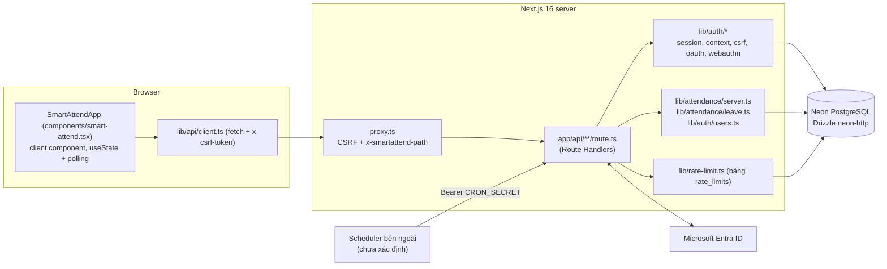
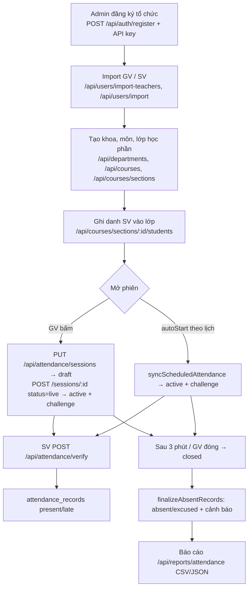
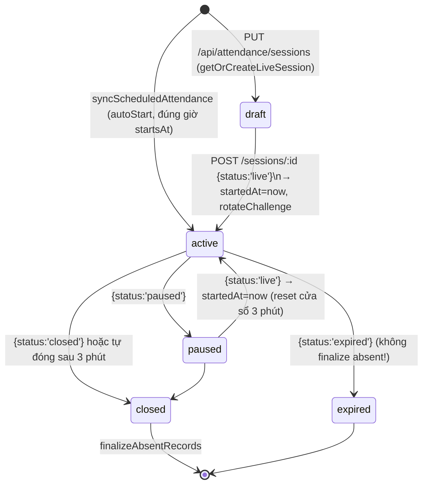
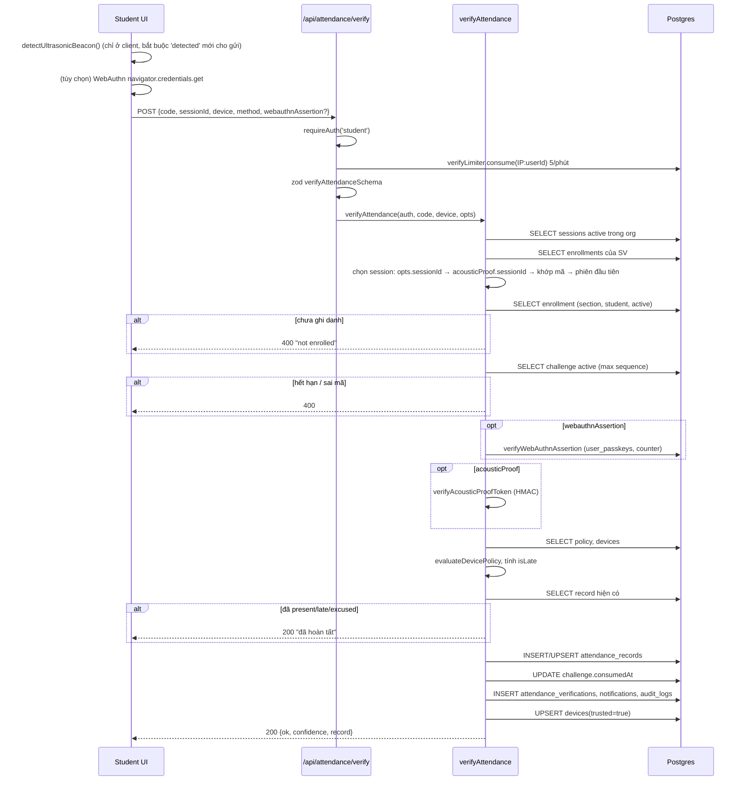
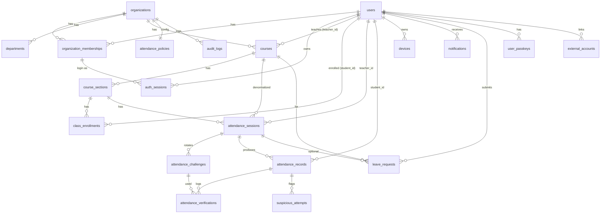

# SmartAttend — Tài liệu bàn giao kỹ thuật cho AI

> Ngày phân tích: 2026-11-14 · Nhánh: `huy` (commit `0a89980`)
> Phương pháp: đọc trực tiếp source code. README và `docs/*.md` chỉ dùng để đối chiếu.
> Ký hiệu trạng thái: ✅ đã có trong code · 🟡 có một phần hoặc chỉ là heuristic · ❌ chưa có · 📄 chỉ có trong tài liệu.
> Ký hiệu độ chắc chắn của lỗi: **[XÁC NHẬN]** đã thấy trực tiếp trong code · **[NGHI VẤN]** suy ra từ code nhưng chưa chạy thử.
> Mọi số dòng đều tính theo commit trên. Nếu file đã bị sửa, hãy tìm theo tên hàm.
>
> **CẬP NHẬT 2026-11-14 — đợt sửa bảo mật:** các mục #1, #3, #4, #7, #9 trong Phần 9 đã được sửa; #5 và #10 (chỉ phần tạo phiên) sửa một phần; #2 và #8 đang chờ chủ dự án quyết định. Chi tiết: [SECURITY_FIX_REPORT.md](SECURITY_FIX_REPORT.md); việc còn mở: [TECHNICAL_DEBT.md](TECHNICAL_DEBT.md); API thay đổi: [API_DOCUMENTATION.md](API_DOCUMENTATION.md); schema: [DATABASE_DESIGN.md](DATABASE_DESIGN.md). Phần mô tả bên dưới phản ánh code **trước** đợt sửa, trừ các chỗ được đánh dấu "✅ ĐÃ SỬA".

---

## 0. TL;DR cho AI tiếp quản

- **Ứng dụng là gì:** Next.js 16.3 App Router full-stack (UI và API cùng một repo), Drizzle ORM trên Neon Postgres qua driver HTTP. Tổ chức theo multi-tenant, phân tách bằng `organization_id`.
- **Chỉ có 3 vai trò:** `student`, `teacher`, `admin` ([lib/types/domain.ts:1](../lib/types/domain.ts)). **Không có vai trò "staff":** `/staff/*` chỉ redirect về `/teacher/login` ([app/staff/[[...slug]]/page.tsx](../app/staff/[[...slug]]/page.tsx)).
- **Nghiệp vụ lõi nằm hết trong** [lib/attendance/server.ts](../lib/attendance/server.ts) (~2.600 dòng).
- **UI gần như nằm hết trong** [components/smart-attend.tsx](../components/smart-attend.tsx) (~7.500 dòng). Mọi page trong `app/**/page.tsx` đều chỉ render `<SmartAttendApp/>`.
- **Middleware ở** [proxy.ts](../proxy.ts) (Next 16 đổi `middleware` thành `proxy`). Chỉ áp cho `/api/*`, làm 2 việc: kiểm tra CSRF và chèn header đường dẫn.
- **Mọi buổi điểm danh chỉ mở 3 phút** (hard-code ở `syncScheduledAttendance` và `getLiveSessionDetails`). Hệ quả: logic "đi muộn" (`lateAfterMinutes`, mặc định 10 phút) **gần như không bao giờ kích hoạt**. Xem mục 9.
- **Driver `neon-http` không dùng transaction tương tác.** Mọi chuỗi ghi nhiều bước đều không nguyên tử.
- **Trước khi sửa Next.js:** đọc `node_modules/next/dist/docs/` (theo yêu cầu của [AGENTS.md](../AGENTS.md)).

---

## PHẦN 1. TỔNG QUAN KIẾN TRÚC

### 1.1 Bài toán
Điểm danh lớp học đại học, chống điểm danh hộ. Giảng viên mở một phiên (session); server sinh mã 6 ký tự, xoay vòng theo TTL và hiển thị dạng text + QR trên màn hình giảng viên. Sinh viên đã đăng ký vào lớp học phần nhập hoặc quét mã trong cửa sổ thời gian để được ghi `present`/`late`. Khi đóng phiên, những sinh viên chưa điểm danh bị ghi `absent`, hoặc `excused` nếu có đơn nghỉ đã duyệt. Hệ thống có thêm cảnh báo cấm thi, đơn xin nghỉ, báo cáo CSV và nhật ký audit.

### 1.2 Nhóm người dùng (đã xác nhận trong code)
| Vai trò | Cổng | Phạm vi quyền thực tế |
|---|---|---|
| `admin` | `/admin/*` | Toàn quyền trong tổ chức của mình. **`requireAuth()` cho admin vượt qua mọi kiểm tra vai trò** ([lib/auth/context.ts](../lib/auth/context.ts) `requireAuth`: `!roles.includes(auth.role) && auth.role !== 'admin'`). Vì vậy `requireAuth('student')` cũng để admin đi qua; sau đó `verifyAttendance` mới tự chặn bằng `auth.role !== 'student'`. |
| `teacher` | `/teacher/*` | Chỉ thao tác được trên course có `courses.teacher_id = mình`. Ngoại lệ: một số endpoint đọc không kiểm tra quyền sở hữu (xem mục 4 và 9). |
| `student` | `/student/*` | Chỉ dữ liệu của mình: điểm danh, đơn nghỉ, thông báo, lịch học. |
| ~~staff~~ | `/staff/*` | ❌ Không tồn tại. Vẫn còn code chết kiểm tra `'staff'` trong `enrollStudentsToSection`, `removeStudentFromSection`, `app/api/reports/attendance`, `app/api/reports/audit`. |

### 1.3 Kiến trúc tổng thể


### 1.4 Công nghệ (theo [package.json](../package.json))
next **16.3.0**, react/react-dom **^19**, typescript **5.7.3**, drizzle-orm **^0.45.2**, drizzle-kit **^0.31.10**, @neondatabase/serverless **^1.1.0**, zod **^4.6.7**, bcryptjs **^3.0.3** (cost 10), arctic **^3.7.0** (OAuth Microsoft), qrcode **^1.5.4**, nanoid **^6**, tailwindcss **^4.3.3**, @base-ui/react, shadcn, lucide-react, @vercel/analytics **1.6.1**, vitest **^4.1.10**. Trình quản lý gói: pnpm (có `pnpm-lock.yaml`). CI dùng Node 20.

### 1.5 Luồng tổng thể


### 1.6 Multi-tenant
- Mỗi tổ chức là một dòng trong `organizations`. Người dùng là identity toàn cục (`users.email` unique toàn hệ thống). Quan hệ user–tổ chức–vai trò nằm ở `organization_memberships` (unique `(organization_id, user_id)`).
- `auth_sessions.membership_id` gắn mỗi phiên đăng nhập với **đúng một membership**. `getAuthContext` ([lib/auth/session.ts](../lib/auth/session.ts)) trả về `organizationId` lấy từ DB, không bao giờ lấy từ client.
- Cô lập dữ liệu được thực hiện **thủ công trong từng query** bằng `eq(table.organizationId, auth.organizationId)`. Không có RLS ở Postgres và không có composite FK bảo đảm tenant nhất quán. Bất kỳ query mới nào quên điều kiện này đều gây rò rỉ dữ liệu giữa các tổ chức.
- Đăng nhập: `resolveMembershipForLogin` lấy mọi membership theo email rồi chọn membership active **đầu tiên**. Nếu một user thuộc nhiều tổ chức thì không có UI chọn tổ chức (chưa hỗ trợ).
- `membership_student_code_idx` là **unique toàn cục**: mã sinh viên không được trùng giữa các tổ chức (migration [drizzle/0002_unique_student_code.sql](../drizzle/0002_unique_student_code.sql)).

### 1.7 Routing và xử lý request
- **Page:** `app/{admin,teacher,student}/[[...slug]]/page.tsx`, `app/page.tsx`, các trang login/register riêng, cùng `account-disabled`, `session-expired`, `unauthorized`, `error`, `not-found`. Page catch-all render `SmartAttendApp`; component này đọc `window.location.pathname` để chọn cổng và trang con (state `page: PageKey`).
- **API:** Route Handlers, export hàm `GET/POST/PUT/PATCH/DELETE`.
- **Chuỗi xử lý một request API:** `proxy.ts` (CSRF) → route handler → `requireAuth(roles)` hoặc `getCurrentAuth()` + `passwordChangePendingResponse()` → `validateRequestBody(request, zodSchema)` ([lib/validation/index.ts](../lib/validation/index.ts)) → hàm service → `NextResponse.json`.
- **Trả lỗi:** `AuthError(status)` cho 401/403/428. 428 nghĩa là bắt buộc đổi mật khẩu, trừ `/api/auth/change-password`, `/api/auth/logout`, `/api/me`.

### 1.8 Thành phần quan trọng
| Thành phần | File | Vai trò |
|---|---|---|
| Middleware | [proxy.ts](../proxy.ts) | CSRF cho mọi request API thay đổi dữ liệu |
| Auth context | [lib/auth/context.ts](../lib/auth/context.ts) | `requireAuth`, `getCurrentAuth`, cổng 428 |
| Session | [lib/auth/session.ts](../lib/auth/session.ts) | Tạo/xóa token, resolve membership |
| Engine điểm danh | [lib/attendance/server.ts](../lib/attendance/server.ts) | Toàn bộ nghiệp vụ |
| Đơn nghỉ | [lib/attendance/leave.ts](../lib/attendance/leave.ts) | CRUD đơn nghỉ, đồng bộ record `excused` |
| Người dùng | [lib/auth/users.ts](../lib/auth/users.ts) | Đăng ký admin, import, đổi/reset mật khẩu |
| Schema | [lib/db/schema.ts](../lib/db/schema.ts) | Nguồn sự thật duy nhất về DB (`schema.sql` đã lỗi thời) |
| API client | [lib/api/client.ts](../lib/api/client.ts) | Mọi lệnh gọi từ UI, tự gắn `x-csrf-token` |
| UI | [components/smart-attend.tsx](../components/smart-attend.tsx), [components/smart-attend-ui.tsx](../components/smart-attend-ui.tsx) | Toàn bộ giao diện |

---

## PHẦN 2. NGHIỆP VỤ THEO CỔNG

### 2.1 Admin
| Chức năng | API | Hàm | Bảng |
|---|---|---|---|
| Đăng ký tổ chức + admin đầu tiên | `POST /api/auth/register` (cần `TEACHER_REGISTRATION_API_KEY`) | `registerAdministrator` | organizations, users, organization_memberships, auth_sessions |
| Import giảng viên (CSV, email phải đúng domain) | `POST /api/users/import-teachers` | `parseTeacherCsv`, `importTeachers` | users, organization_memberships |
| Import sinh viên (CSV) | `POST /api/users/import` | `parseStudentCsv`, `importStudents` | users, organization_memberships, class_enrollments, courses.enrolled |
| Reset mật khẩu SV về mặc định | `POST /api/users/reset-student-password` | `adminResetStudentPassword` | users, auth_sessions (xóa) |
| Khoa/bộ môn CRUD | `/api/departments` GET/POST/PATCH/DELETE | `listDepartmentsWithDetails`, `createDepartment`, `updateDepartment`, `deleteDepartment` | departments (+ cập nhật chuỗi `department` ở courses/memberships, chưa kiểm chứng chi tiết) |
| Đổi giảng viên của môn | `PATCH /api/courses/:id` | `updateCourseTeacher` | courses |
| Cấu hình domain email | `PATCH /api/organization/email-domain` | (inline) | organizations |
| Xem audit log | `GET /api/audit-logs`, `GET /api/reports/audit` (CSV) | `listAuditLogs` | audit_logs |
| Xem người dùng / thiết bị | `GET /api/users?role=&kind=` | `listUsers`, `listDepartments`, `listDevices` | memberships, users, devices |
| Mọi chức năng của Teacher | — | — | — (admin vượt qua kiểm tra vai trò và kiểm tra sở hữu) |

**Quy tắc riêng:**
- Mật khẩu mặc định: SV = **chính mã SV**; GV = **`Gv@123456`** dùng chung cho mọi GV ([lib/auth/default-credentials.ts](../lib/auth/default-credentials.ts)). Cả hai đều được đặt `mustChangePassword = true`.
- Email SV được sinh tự động: `studentEmailFromName` tạo `<chữ cái đầu tên><mã SV>@utc.edu.vn`, **hard-code domain utc.edu.vn**.
- Import SV mà không chọn `courseId` → **tự ghi danh SV vào TẤT CẢ lớp học phần của tổ chức** (`autoEnrollSections !== false`).

### 2.2 Teacher
| Chức năng | API | Hàm |
|---|---|---|
| Xem môn mình dạy | `GET /api/courses` | `listCourses(org, teacherId)` |
| Tạo môn (gán cho mình hoặc GV khác) | `POST /api/courses` | `createCourse` (teacher **được phép** tạo môn) |
| Tạo/sửa/xóa lớp học phần | `/api/courses/sections`, `/api/courses/sections/:id` | `createCourseSection`, `updateCourseSection`, `deleteCourseSection` (có kiểm tra sở hữu) |
| Ghi danh / gỡ SV | `/api/courses/sections/:id/students` POST/DELETE | `enrollStudentsToSection`, `removeStudentFromSection` (có kiểm tra sở hữu) |
| Xem roster / tìm SV | `GET /api/courses/sections/:id[/students]` | `listSectionStudents`, `searchAvailableStudentsForSection` (**không kiểm tra sở hữu**) |
| Mở phiên | `PUT /api/attendance/sessions` {sectionId} | `getOrCreateLiveSession` |
| Bắt đầu / tạm dừng / đóng / xoay mã | `POST /api/attendance/sessions/:id` {status \| action:'rotate'} | `transitionSessionState`, `rotateChallengeForSession` |
| Xem phiên live (mã, roster, đồng hồ) | `GET /api/attendance/sessions/:id`, `GET /api/attendance/sessions` | `getLiveSessionDetails` |
| Điểm danh thủ công | `POST/PATCH /api/attendance/records` | `manualCheckInStudent`, `overrideRecordStatus` |
| Duyệt đơn nghỉ | `PATCH /api/attendance/leave` | `updateLeaveRequestStatus` |
| Xử lý cảnh báo nghi vấn | `PATCH /api/attendance/suspicious` | `resolveSuspiciousAttempt` |
| Chỉnh chính sách điểm danh | `PATCH /api/attendance/policy` | `updateAttendancePolicy` (**teacher sửa được policy của cả tổ chức**) |
| Báo cáo, phiếu in A4 | `GET /api/reports/attendance?courseId&scope&format=json` | `listReportRecords`, `getCourseAttendanceSummary` |
| Reset mật khẩu SV trong lớp mình | `POST /api/users/reset-student-password` | `adminResetStudentPassword` (SEC-14) |
| Phát sóng siêu âm | (client) | `startUltrasonicBeacon` trong `StaffView` |

### 2.3 Student
| Chức năng | API | Hàm |
|---|---|---|
| Dashboard (môn, lịch, record, thông báo, đơn) | `GET /api/dashboard` | nhánh `auth.role === 'student'` |
| Điểm danh | `POST /api/attendance/verify` | `verifyAttendance` |
| Xem lịch / phiên đang mở (mã bị che `------`) | `GET /api/attendance/sessions` | `listClassSessions(org, studentId)` |
| Lịch sử điểm danh | `GET /api/attendance/records` | `listRecords` (ép `studentId = auth.userId`) |
| Gửi / xem đơn nghỉ kèm ảnh | `POST/GET /api/attendance/leave` | `addLeaveRequest`, `getLeaveRequests` |
| Thông báo | `GET/POST /api/notifications` | `listNotifications`, `markNotificationsRead` |
| Đăng ký passkey | `GET /api/auth/webauthn/challenge`, `POST /api/auth/webauthn/register` | `generateWebAuthnChallenge`, `saveUserPasskey` |
| Đổi mật khẩu | `POST /api/auth/change-password` | `changeUserPassword` |
| Tự reset mật khẩu | `POST /api/auth/reset-password` | `selfServiceResetPassword` → **luôn từ chối** (SEC-02) |

**Cảnh báo chuyên cần** (`finalizeAbsentRecords`): khi số buổi `absent` trong môn **= 2** → gửi thông báo "Nguy cơ cấm thi"; **≥ 3** → "Bị cấm thi". Mỗi lần đóng phiên mà SV vắng thêm sẽ gửi thêm một thông báo. Ở báo cáo, `getCourseAttendanceSummary` tính `warningStatus` và `examEligibility` (quy tắc >20% hoặc ≥3 buổi theo README; chưa đọc chi tiết công thức, cần đối chiếu khi sửa).

### 2.4 Staff
❌ Không tồn tại như một vai trò. Login với `portal: 'staff'` vẫn được chấp nhận như cổng cũ gộp teacher+admin (`isLegacyStaffPortal`).

### 2.5 Vòng đời một buổi điểm danh

Bảng chuyển trạng thái nằm ở [lib/attendance/session-state.ts](../lib/attendance/session-state.ts). DB lưu `active`; API/UI gọi là `live` (`mapSessionStatus`).

---

## PHẦN 3. LUỒNG ĐIỂM DANH CHI TIẾT

| # | Câu hỏi | Trả lời từ code |
|---|---|---|
| 1 | Tạo session | `PUT /api/attendance/sessions` → `getOrCreateLiveSession(auth, sectionId)` (server.ts ~1329). Kiểm tra section thuộc tổ chức; teacher phải là `courses.teacherId`. Nếu đã có phiên `active/draft/paused` của section thì trả lại id đó; nếu chưa thì insert `status='draft'`, `teacherId=auth.userId`. **Không có unique index chặn 2 phiên mở song song** (race condition). |
| 2 | Kích hoạt / tạm dừng / tiếp tục / đóng | `POST /api/attendance/sessions/:id` (rate limit 30/phút) → `transitionSessionState` (~571): kiểm tra tổ chức và quyền sở hữu → `canTransition` → cập nhật `status`, `startedAt` (khi active) hoặc `closedAt` → active thì `rotateChallengeForSession`, closed thì `finalizeAbsentRecords` → `appendAudit`. |
| 3 | Sinh mã OTP | `generateChallengeValue()` ([lib/attendance/challenge.ts](../lib/attendance/challenge.ts)): `crypto.randomBytes(6)`, ánh xạ `byte % 32` vào bảng `ABCDEFGHJKLMNPQRSTUVWXYZ23456789` (bỏ I, O, 0, 1). 256 chia hết cho 32 nên không bị modulo bias. Không gian mã 32⁶ ≈ 1,07 tỷ. |
| 4 | QR | Client-side: `DynamicQRCode` ([components/smart-attend-ui.tsx:370](../components/smart-attend-ui.tsx)) gọi `QRCode.toString(value)` với **value = mã 6 ký tự thô**, không phải URL hay token ký. SV quét bằng `getUserMedia` + `BarcodeDetector` (smart-attend.tsx ~316). |
| 5 | Mã đổi theo thời gian | Mỗi challenge có `expiresAt = now + policy.challengeTtlSeconds` (mặc định 30s). **Server không có timer.** Mã mới chỉ được sinh khi (a) chuyển sang active, (b) GV gọi `action:'rotate'`, hoặc (c) `getLiveSessionDetails` thấy mã hết hạn và tự xoay. UI GV poll 5 giây/lần khi có phiên live (smart-attend.tsx ~7189), nên trên thực tế mã đổi khoảng mỗi 30–35 giây **chỉ khi màn hình GV đang mở**. |
| 6 | Lưu challenge | `rotateChallengeForSession` (~501): đánh dấu challenge active cũ là `invalidated`, `sequence = latest.sequence + 1` (unique `(session_id, sequence)`), insert `{code: value, valueHash, status:'active', expiresAt}`, đồng thời lưu bản rõ vào `challengePlainCache` (Map trong bộ nhớ). ⚠️ **Mã được lưu dạng rõ ở cột `code`** bên cạnh hash. |
| 7 | Hash | `hashChallengeValue = sha256(value.trim().toUpperCase())` dạng hex. `verifyChallengeValue` so sánh chuỗi bằng `===`, không constant-time (rủi ro thấp vì đã hash). |
| 8 | API SV | `POST /api/attendance/verify` body `{code, device?, method?, sessionId?, ultrasonicVerified?, biometricVerified?, webauthnAssertion?, acousticProof?}` (schema [lib/validation/schemas/attendance.schema.ts](../lib/validation/schemas/attendance.schema.ts)). Rate limit 5 lần/phút cho mỗi `IP:userId`. |
| 9 | Xác minh | `verifyAttendance` (~749), xem sequence diagram bên dưới. |
| 10 | Thời hạn | `challenge.expiresAt < new Date()` → từ chối. Ngoài ra cả phiên chỉ sống 3 phút (`ATTENDANCE_WINDOW_MS`). |
| 11 | Chống replay | Chỉ ở mức: mã hết hạn sau TTL, mã cũ bị `invalidated` khi xoay, và mỗi SV có tối đa 1 record cho mỗi session (unique index). **Mã KHÔNG dùng một lần**: `consumedAt` chỉ được ghi lại, challenge vẫn active cho các SV khác. Một mã bị chia sẻ ra ngoài lớp vẫn dùng được trong TTL. `acousticProof` (HMAC theo session + sequence + khung 30s) có thể replay trong ±60s. |
| 12 | Thuộc lớp | Truy vấn `class_enrollments` theo `(sectionId = live.sectionId, studentId, status='active')`. |
| 13 | Thiết bị | `device` là **chuỗi do client gửi lên** (mặc định `'This browser'`; UI gửi kiểu "Apple iPhone (Face ID + Ultrasonic)"). Server so khớp với `devices.label` → `evaluateDevicePolicy` ([lib/attendance/device-policy.ts](../lib/attendance/device-policy.ts)). Khi `requireTrustedDevice=false` thì luôn cho qua (điểm 98/85/78). Khi `true` thì chỉ chấp nhận thiết bị đã trusted. Sau mỗi lần điểm danh thành công, thiết bị đó được upsert `trusted=true`, nên **lần đầu tiên luôn tự trust** khi policy tắt. Không có fingerprint thật. |
| 14 | Trùng | Nếu record đã là `present/late/excused` → trả `ok:true` kèm thông báo "đã hoàn tất" (idempotent, **không tạo verification mới**). Nếu record là `absent` (do GV ghi tay) → cập nhật thành present/late. Insert dùng `onConflictDoUpdate` trên `(session_id, student_id)`. |
| 15 | Muộn / đúng giờ | `isLate = verifiedAt > live.startedAt + lateAfterMinutes*60s` (mặc định 10 phút). Vì phiên tự đóng sau 3 phút, **với cấu hình mặc định không SV nào bị ghi `late`** qua luồng tự điểm danh. |
| 16 | Ghi record | Insert hoặc update `attendance_records` → cập nhật `attendance_challenges.consumedAt` → insert `attendance_verifications` (method, metadata) → insert `notifications` → `appendAudit` → upsert `devices` → (nếu `deviceDecision.suspicious`) insert `suspicious_attempts`. Thực tế nhánh cuối không bao giờ chạy, vì mọi trường hợp suspicious đều đã bị `allowed:false` chặn từ trước. |
| 17 | Mất kết nối / gửi lặp | Không có idempotency key. Gửi lặp sau khi đã ghi → trả "đã hoàn tất". Hai request đồng thời → cả hai cùng qua bước kiểm tra trùng, `onConflictDoUpdate` giữ một record, nhưng sẽ có **2 verifications, 2 notifications, 2 audit log** [NGHI VẤN]. Giới hạn 5 lần/phút có thể khóa SV gõ sai nhiều lần. |
| 18 | Tự đánh vắng | `finalizeAbsentRecords` (~627): lấy enrollment active → bỏ SV đã có record → SV có đơn nghỉ approved (khớp `sessionId` hoặc so khớp ngày bằng `includes`) thì ghi `excused`, còn lại ghi `absent` → insert `onConflictDoNothing` → gửi cảnh báo cấm thi. Được gọi khi `→closed` thủ công, khi `syncScheduledAttendance` tự đóng, và khi `getLiveSessionDetails` tự đóng. **Không được gọi khi `→expired`.** |

### 3.1 Sequence: giảng viên mở phiên
```mermaid
sequenceDiagram
  participant T as Teacher UI
  participant P as proxy.ts
  participant S as /api/attendance/sessions
  participant SV as server.ts
  participant DB as Postgres
  T->>P: PUT /api/attendance/sessions {sectionId} + x-csrf-token
  P->>P: validateCsrfProtection (Origin/Referer/Sec-Fetch-Site/double-submit)
  P->>S: forward + x-smartattend-path
  S->>SV: requireAuth(['teacher','admin']) → getAuthContext(token)
  SV->>DB: SELECT auth_sessions⋈users⋈memberships⋈organizations
  S->>SV: getOrCreateLiveSession(auth, sectionId)
  SV->>DB: SELECT section⋈course (org, owner)
  SV->>DB: SELECT session status in (active,draft,paused)
  SV->>DB: INSERT attendance_sessions(status='draft')
  S-->>T: {ok, sessionId}
  T->>S: POST /api/attendance/sessions/:id {status:'live'}
  S->>DB: rate_limits upsert (30/phút)
  S->>SV: transitionSessionState → canTransition(draft→active)
  SV->>DB: UPDATE status='active', startedAt=now
  SV->>SV: rotateChallengeForSession: generateChallengeValue()
  SV->>DB: UPDATE challenge cũ invalidated; INSERT challenge(seq+1, code, valueHash, expiresAt)
  SV->>DB: INSERT audit_logs
  S-->>T: {ok, status:'live'}
  loop mỗi 5 giây
    T->>S: GET /api/dashboard / /api/attendance/sessions/:id
    S->>SV: getLiveSessionDetails → nếu >3 phút: closed + finalizeAbsentRecords
    SV->>SV: nếu challenge hết hạn → rotate
    S-->>T: {challenge, remainingSeconds, records[]}
  end
```

### 3.2 Sequence: sinh viên điểm danh


**Lưu ý thực tế:** UI sinh viên **không bao giờ gửi `acousticProof`**, vì server che mã và không trả acousticProof cho SV (`listClassSessions` đặt `acousticProof: undefined`). Do đó `isUltrasonicBiometric` luôn là `false` và điểm tối đa qua UI là 98. Kiểm tra sóng siêu âm 🟡 chỉ là cổng chặn phía client (`ultrasonicStatus !== 'detected'`); server không kiểm chứng. `ultrasonicVerified`/`biometricVerified` gửi lên bị server bỏ qua (đúng nguyên tắc zero-trust).

---

## PHẦN 4. BẢO MẬT

| Cơ chế | Vị trí | Cách hoạt động | Điểm yếu / rủi ro |
|---|---|---|---|
| Authentication | `app/api/auth/login/route.ts`, `lib/auth/session.ts` | Body `{identifier\|email, password, portal}`. SV đăng nhập bằng mã SV hoặc email; staff bằng email. Kiểm tra cổng khớp vai trò (`wrong_portal`). Tài khoản bị khóa trả 403 **chỉ khi đúng mật khẩu**. | Phản hồi `wrong_portal` và `account_disabled` tiết lộ trạng thái tài khoản (chỉ sau khi đúng mật khẩu, rủi ro thấp). Chọn membership active đầu tiên, chưa hỗ trợ đa tổ chức. |
| RBAC | `requireAuth` + kiểm tra trong service | Kiểm tra vai trò ở route; kiểm tra sở hữu (`courses.teacherId`) trong từng hàm service. | Admin vượt qua mọi kiểm tra vai trò. Một số route dùng `getCurrentAuth` rồi tự kiểm tra role → dễ không nhất quán. Thiếu kiểm tra sở hữu ở `listSectionStudents`, `searchAvailableStudentsForSection`, `listClassSessions` (teacher thấy mã của GV khác), `updateAttendancePolicy` (teacher sửa policy toàn tổ chức). |
| Session token | `createAuthSession` | 32 byte ngẫu nhiên (hex), DB lưu SHA-256, TTL 7 ngày. `getAuthContext` từ chối nếu user bị khóa hoặc membership không active. | Không có sliding expiry, không có danh sách phiên. Đổi mật khẩu tạo phiên mới, **không rõ có xóa phiên cũ không** (chưa xác định). Admin reset mật khẩu SV có xóa toàn bộ phiên của SV. Không có job dọn `auth_sessions` hết hạn. |
| Cookie | `lib/auth/cookies.ts`, `lib/storage/cookie-storage.ts` | Session cookie: `HttpOnly`, `SameSite=Lax`, `Secure` khi production, path `/`. CSRF cookie `smartattend_csrf` có `httpOnly:false`. | Ổn. |
| CSRF | `proxy.ts` → `lib/auth/csrf.ts` | Với POST/PUT/PATCH/DELETE: chặn `Sec-Fetch-Site: cross-site`; Origin (hoặc Referer) phải đáng tin; double-submit **chỉ khi có cookie CSRF**. | Request không có Origin/Referer/cookie CSRF (client không phải trình duyệt) đi qua; chấp nhận được vì cookie là Lax. Ở môi trường khác production thì tin mọi Host header. **[NGHI VẤN] Bug:** [lib/auth/webauthn-client.ts](../lib/auth/webauthn-client.ts) gọi `fetch('/api/auth/webauthn/register')` **không kèm `x-csrf-token`**, trong khi login đã đặt cookie CSRF → proxy sẽ trả 403 "Missing CSRF token" → đăng ký passkey từ UI thất bại. |
| Password hashing | `lib/auth/password.ts` | bcryptjs cost 10. | Cost hơi thấp so với khuyến nghị hiện nay. Mật khẩu mặc định đoán được: SV = mã SV, GV = `Gv@123456`. Được giảm nhẹ bằng `mustChangePassword` + cổng 428, nhưng trong khoảng thời gian trước khi đổi thì ai biết mã SV cũng đăng nhập được. |
| Microsoft OAuth | `app/api/auth/microsoft/route.ts`, `callback/route.ts`, `lib/auth/oauth.ts` | Arctic, PKCE + `state` lưu trong cookie, so khớp state. `decodeIdToken` (không verify chữ ký, nhưng id_token lấy trực tiếp từ token endpoint qua TLS nên chấp nhận được). Lần đầu tự liên kết theo email. | Tự liên kết theo `email`/`preferred_username` → nếu `MICROSOFT_TENANT_ID` là `common`/`organizations` hoặc bỏ trống, **bất kỳ tài khoản Microsoft nào có `preferred_username` trùng email trong hệ thống đều chiếm được tài khoản đó** [NGHI VẤN, phụ thuộc cấu hình]. Kiểm tra tenant bị bỏ qua nếu thiếu `tid`. |
| WebAuthn | `lib/auth/webauthn.ts`, `webauthn-client.ts` | Challenge không trạng thái, ký HMAC (TTL 5 phút). Xác minh assertion: type, challenge, origin, rpIdHash, UP/UV, counter, chữ ký bằng `crypto.verify` với khóa PEM. | (1) **Đăng ký không xác minh attestation**: server lưu nguyên `publicKey` client gửi lên → SV có thể đăng ký khóa phần mềm tự tạo, "sinh trắc học" không chứng minh được gì. (2) `assertion.origin` do client gửi **ghi đè expected origin**. (3) `clientData.origin` vắng mặt thì bỏ qua kiểm tra. (4) Challenge không dùng một lần (replay được trong 5 phút). (5) Fallback lưu `attestationObject` base64 như publicKey → verify sẽ lỗi. |
| Rate limiting | `lib/rate-limit.ts` (bảng `rate_limits`) | Cửa sổ cố định (comment ghi là "sliding" nhưng thực tế là fixed window), upsert nguyên tử. Login 10/15 phút, verify 5/phút, register 5/15 phút, đổi mật khẩu 5/15 phút, reset 5/15 phút, session action 30/phút, import 10/15 phút. | `clientIp` tin `x-vercel-forwarded-for`/`cf-connecting-ip`; nếu không deploy sau Vercel/Cloudflare thì các header này giả mạo được. Không có rate limit cho WebAuthn, leave, notifications, các GET. Bảng `rate_limits` không được dọn. |
| Brute force | loginLimiter theo `IP:identifier` | | Kẻ tấn công đổi IP thì có thể thử nhiều tài khoản. Không có khóa tài khoản. |
| Replay | Xem mục 3 #11 | | Mã dùng chung cả lớp trong TTL; chia sẻ mã qua chat vẫn hiệu quả trong 30 giây. Tham số `sessionId` cho phép chọn phiên, nhưng enrollment vẫn được kiểm tra. |
| Giả mạo request | zod ở hầu hết route | | Thiếu zod ở: `PATCH /api/courses/:id` (đọc `body.teacherId` thô), `POST /api/notifications` (`body.ids`), `POST /api/auth/webauthn/register` (body thô), `POST /api/courses/sections/:id/students` (chưa đọc kỹ, cần kiểm tra). |
| Tenant isolation | Từng query | Lọc theo `auth.organizationId`. | `importStudents`: kiểm tra mã SV đã tồn tại **không lọc theo tổ chức** → nếu trùng mã ở tổ chức khác (khi có `courseId`) sẽ ghi danh user của tổ chức khác vào lớp của tổ chức này. Nhánh "email trùng" **ghi đè `passwordHash` của user đã có** bất kể tổ chức hay vai trò. `verifyAttendance` lấy enrollment của SV không lọc org (không gây hại vì session đã lọc org). `listSectionStudents` có lọc org. |
| Upload file | `lib/validation/schemas/leave.schema.ts` | Ảnh đính kèm là data URL base64, regex giới hạn png/jpeg/webp/gif, tối đa 200KB, **lưu thẳng vào cột `leave_requests.attachment_url`**. | Không kiểm tra magic bytes (giả MIME được). Hiển thị dạng ``, CSP `img-src data:` → rủi ro XSS thấp (gif/svg không được chấp nhận). DB phình to. `getLeaveRequests` trả toàn bộ base64 trong danh sách. |
| Bảo vệ API | — | Mọi route trừ login, register, reset, OAuth và cron đều yêu cầu phiên đăng nhập. Cron yêu cầu `CRON_SECRET` (so sánh constant-time) và bị vô hiệu hóa nếu chưa cấu hình. | `GET /api/attendance/sessions` cho teacher trả **mã rõ của mọi phiên live trong tổ chức**. |
| Dữ liệu nhạy cảm | — | Không log mật khẩu. Header bảo mật: CSP, HSTS (production), X-Frame-Options DENY, nosniff ([next.config.mjs](../next.config.mjs)). | Cột `attendance_challenges.code` lưu mã rõ. Response import trả về mật khẩu mặc định. CSP có `'unsafe-inline'` cho script. Secret mặc định cho môi trường dev bị hard-code (`smartattend_acoustic_proof_secret`, `smartattend_webauthn_challenge_secret`); production sẽ throw nếu thiếu. `SESSION_SECRET` fallback sang `TEACHER_REGISTRATION_API_KEY` (dùng chung secret). |

**Kết luận:** Chưa có bằng chứng kiểm chứng (pentest hoặc test chạy trên môi trường production) để khẳng định hệ thống an toàn. Các mục trên là kết quả đọc code tĩnh.

---

## PHẦN 5. DATABASE

Nguồn sự thật: [lib/db/schema.ts](../lib/db/schema.ts). Migration nằm trong [drizzle/](../drizzle/) (0000–0003), nhưng script dùng `drizzle-kit push`. [lib/db/schema.sql](../lib/db/schema.sql) là bản nháp cũ, **đừng dùng**. Mọi PK là `text` (nanoid hoặc tiền tố như `org_`, `adm_`, `stu_`, `crs_`, `lr_`, `pk_`, `rec_`). Mọi cột thời gian là `timestamptz`, **trừ** `course_sections.starts_at/ends_at` (text `HH:mm`), `start_date/end_date` (text `YYYY-MM-DD`) và `leave_requests.date` (text tự do).

| Bảng | Mục đích | Cột chính | Ràng buộc / index | Tenant |
|---|---|---|---|---|
| organizations | Tổ chức (tenant) | name, plan, email_domain | PK id | chính nó |
| users | Identity toàn cục | email (unique), password_hash, name, initials, must_change_password, disabled_at | | ❌ không có org |
| organization_memberships | user ↔ org ↔ role | role, department (text), student_code, status | unique(org,user), **unique(student_code) toàn cục**, idx(org,role) | ✅ |
| auth_sessions | Phiên đăng nhập | token_hash (unique), membership_id, expires_at | idx(user) | qua membership |
| departments | Khoa | name | unique(org,name) | ✅ |
| courses | Môn học | code, name, department (text, không FK), teacher_id (FK users), enrolled (đếm cache), color, status | unique(org,code) | ✅ |
| course_sections | Lớp học phần + lịch tuần | course_id, room, starts_at, ends_at, start_date, end_date, day_of_week (1=T2…7=CN), auto_start, status | idx(org,course), idx(org,day) | ✅ |
| class_enrollments | SV ↔ lớp | section_id, student_id, status | **unique(section,student)** (không có PK), idx(org,student) | ✅ |
| attendance_sessions | Buổi điểm danh | section_id, course_id (dư thừa), teacher_id, status, started_at, closed_at | idx(org,status), idx(section) | ✅ |
| attendance_challenges | Mã xoay | session_id, sequence, **code (rõ)**, value_hash, status (active/invalidated), expires_at, consumed_at | unique(session,sequence), idx(session,status) | ✅ |
| attendance_records | Kết quả mỗi SV mỗi buổi | session_id, student_id, status (present/late/absent/excused), verification_score, verified_at, device, flagged_reason | **unique(session,student)**, idx(org,student) | ✅ |
| attendance_verifications | Lịch sử xác minh | attendance_record_id, challenge_id, method, result, metadata jsonb | ⚠️ không có index | ✅ |
| devices | Thiết bị SV | student_id, label, trusted, last_seen_at | idx(org,student); không có unique(student,label) | ✅ |
| suspicious_attempts | Hàng đợi xem xét | attendance_record_id, reason, status (open/resolved), reviewed_by | ⚠️ không có index | ✅ |
| notifications | Hộp thư | user_id, title, body, read_at | idx(org,user) | ✅ |
| attendance_policies | Chính sách theo tổ chức | late_after_minutes (10), challenge_ttl_seconds (30), require_trusted_device (false) | unique(org) | ✅ |
| audit_logs | Nhật ký | actor_id, actor_name, action, target, severity, metadata | idx(org,created_at) | ✅ |
| leave_requests | Đơn nghỉ | student_id, course_id, session_id?, date (text), reason, evidence_note, attachment_url (base64), status, reviewed_* | idx(org,student), idx(org,status) | ✅ |
| user_passkeys | Passkey | credential_id (unique), public_key (PEM), counter | idx(user) | ❌ |
| rate_limits | Bộ đếm rate limit | key (PK), hits, reset_at | | ❌ |
| external_accounts | Liên kết OAuth | provider, provider_account_id, email | unique(provider, provider_account_id) | ❌ |

### 5.1 ERD


### 5.2 Luồng dữ liệu
- **Tạo người dùng:** Admin: `registerAdministrator` insert organizations → users → memberships (không có transaction; nếu lỗi giữa chừng sẽ để lại tổ chức mồ côi). GV: `importTeachers` (email = local part + `@emailDomain`) insert users và memberships với mật khẩu mặc định. SV: `importStudents` insert users (hoặc ghi đè user trùng email) → memberships → enrollments → tính lại `courses.enrolled` cho mọi môn của tổ chức.
- **Tạo khóa học:** `createCourse` kiểm tra teacher hợp lệ → insert courses → audit.
- **Tạo lớp học phần:** `createCourseSection` (có tùy chọn `enrollAll`, `initialStudentIds`) → course_sections (+ enrollments).
- **Ghi danh:** `enrollStudentsToSection(identifiers)` → tìm membership student theo mã SV/email trong tổ chức → insert class_enrollments `onConflictDoNothing` → cập nhật `courses.enrolled`.
- **Tạo buổi điểm danh:** xem 3.1 (attendance_sessions, attendance_challenges, audit_logs).
- **SV điểm danh:** xem 3.2 (attendance_records, attendance_challenges.consumed_at, attendance_verifications, notifications, audit_logs, devices, [suspicious_attempts]).
- **Đóng buổi:** UPDATE attendance_sessions → `finalizeAbsentRecords` (records absent/excused, notifications cảnh báo) → audit.
- **Xuất báo cáo:** `listReportRecords` join records ⋈ users ⋈ sessions ⋈ sections ⋈ courses → `toCsv` ([lib/reports/csv.ts](../lib/reports/csv.ts), UTF-8 BOM, RFC 4180). JSON cho phiếu in dùng `getCourseAttendanceSummary`.

---

## PHẦN 6. FRONTEND VÀ UI

- **Trang:** mọi route render `SmartAttendApp` ([components/smart-attend.tsx:7058](../components/smart-attend.tsx)). Không có layout riêng cho từng cổng; [app/layout.tsx](../app/layout.tsx) chỉ bọc `Providers` (i18n) và Vercel Analytics.
- **Routing phía client:** `SmartAttendApp` đọc `window.location.pathname`, gọi `api.me()` để lấy user, rồi đặt state `role`, `authScreen` (landing/login/register) và `page: PageKey`. Điều hướng bằng `router.push` và `go(page)`.
- **Auth ở frontend:** chỉ để hiển thị (gọi `/api/me`). Cổng bắt đổi mật khẩu dùng `ChangePasswordForm`. Bảo mật thật nằm ở server. Không có route guard ở server cho page; dữ liệu chỉ lộ qua API.
- **Component:** `StudentView` (~131), `StaffView` (~4044, dùng chung cho teacher/admin qua prop `role`), các modal (`ClassRosterModal`, `DepartmentModal`, `DeleteDepartmentModal`, `CourseModal`, `ScheduleModal`, `ProofPreviewModal`, `PrintableAttendanceSheetModal`), `StudentImportPanel`, `TeacherImportPanel`, `NotificationBell`, `UserProfileDropdown`, `ChangePasswordForm`. Primitive UI (`Button`, `Card`, `CountdownTimer`, `DynamicQRCode`, `calcAttendanceRate`, kiểu dữ liệu) nằm ở [components/smart-attend-ui.tsx](../components/smart-attend-ui.tsx). Ngoài ra có [components/utc-login-landing.tsx](../components/utc-login-landing.tsx), [components/utc-student-dashboard.tsx](../components/utc-student-dashboard.tsx), [components/auth/auth-screens.tsx](../components/auth/auth-screens.tsx), [components/cookie-consent-banner.tsx](../components/cookie-consent-banner.tsx). Thư mục `components/shared/notification-bell.tsx` tồn tại song song với `NotificationBell` bên trong smart-attend.tsx (có dấu hiệu trùng lặp).
- **State:** chỉ dùng `useState`/`useEffect` cục bộ. Không có Redux/Zustand/React Query. `data: DashboardData` lấy từ `GET /api/dashboard`; poll **5 giây** khi có phiên live, **15 giây** khi không, và poll lại khi tab trở về visible.
- **Gọi API:** [lib/api/client.ts](../lib/api/client.ts) (`api.*`) tự gắn `x-csrf-token` từ cookie. Có vài chỗ gọi `fetch` trực tiếp (smart-attend.tsx ~4100 để tải báo cáo; webauthn-client.ts để đăng ký passkey, **thiếu CSRF header**).
- **Lỗi / loading:** state cục bộ (`stepNotice`, `reportNotice`, `actionMessage`…). Lỗi polling bị nuốt im lặng. Có [components/route-states.tsx](../components/route-states.tsx) cho trang lỗi chung.
- **Responsive:** Tailwind 4 utility classes, chưa kiểm chứng trên thiết bị thật.
- **i18n:** [lib/i18n/](../lib/i18n/) gồm `vi.ts` và `en.ts` (mỗi file 704 dòng), `I18nProvider` và `LanguageSwitcher`. Nhiều chuỗi tiếng Việt vẫn hard-code trong component và trong thông báo lỗi của server (server trả lẫn tiếng Anh và tiếng Việt).

### 6.1 Đề xuất tách smart-attend.tsx (giữ nguyên hành vi)
Thứ tự tách để an toàn, mỗi bước là một PR riêng và kiểm tra bằng `pnpm typecheck` + chạy thử UI:
1. `components/smart-attend/shared/`: `ChangePasswordForm`, `NotificationBell` (gộp với `components/shared/notification-bell.tsx`), `UserProfileDropdown`, `studentEmailForDisplay`, `parseSessionType`.
2. `components/smart-attend/modals/`: mỗi modal một file. Các modal chỉ phụ thuộc props và `api`.
3. `components/smart-attend/admin/`: `StudentImportPanel`, `TeacherImportPanel`, quản lý khoa và người dùng (các nhánh `page === ...` trong `StaffView` khi `role==='admin'`).
4. `components/smart-attend/teacher/`: phần live session (beacon siêu âm, QR, đồng hồ, roll call), lịch, báo cáo.
5. `components/smart-attend/student/`: tách `StudentView` theo page (`join`, lịch sử, đơn nghỉ, thông báo); logic verify chuyển thành hook `useAttendanceVerify`.
6. `components/smart-attend/app-shell.tsx`: `SmartAttendApp` + hook `useDashboardPolling`, `useAuthBootstrap`.

**Phụ thuộc cần giữ nguyên:** `ViewProps` (`page`, `go`, `data`, `user`, `refresh`), kiểu `DashboardData` trong `lib/api/client.ts`, `useI18n().t`. Hiện `StaffView` dùng chung nhiều state cho cả teacher và admin, nên khi tách cần chuyển state xuống đúng component con.

---

## PHẦN 7. API DOCUMENTATION

Chú thích: **Auth** = cơ chế kiểm tra. `RA(x)` = `requireAuth(x)`, trong đó admin luôn đi qua. `CA` = `getCurrentAuth` + tự kiểm tra (+ 428). Mọi request thay đổi dữ liệu đều đi qua CSRF ở `proxy.ts`.

### 7.1 Authentication
| Method | Endpoint | Mục đích | Body / query | Auth | Validation | Bảng | Hàm |
|---|---|---|---|---|---|---|---|
| POST | /api/auth/login | Đăng nhập | identifier\|email, password, portal(student/teacher/admin/staff) | công khai, rate 10/15 phút | loginSchema | users, memberships, auth_sessions, rate_limits | route + `resolveMembershipFor*Login` |
| POST | /api/auth/logout | Đăng xuất | — | cookie | — | auth_sessions | `deleteAuthSession` |
| POST | /api/auth/register | Tạo tổ chức + admin | name, email, password, organizationName, emailDomain?, apiKey | API key + rate 5/15 phút | registerAdminSchema | organizations, users, memberships, auth_sessions | `registerAdministrator` |
| POST | /api/auth/change-password | Đổi mật khẩu | currentPassword, newPassword | RA() + rate 5/15 phút | changePasswordSchema | users, auth_sessions | `changeUserPassword` |
| POST | /api/auth/reset-password | Tự reset | identifier, portal, newPassword? | công khai + rate | resetPasswordSchema | users, memberships, external_accounts | `selfServiceResetPassword` (luôn trả `ok:false`) |
| GET | /api/auth/microsoft | Bắt đầu OAuth | ?portal= | công khai | parsePortal | — (cookie state, verifier) | `getMicrosoftAuth` |
| GET | /api/auth/microsoft/callback | Callback | code, state | state + PKCE | — | external_accounts, users, memberships, auth_sessions, audit_logs | route |
| GET | /api/auth/webauthn/challenge | Lấy challenge + danh sách passkey | — | RA() | — | user_passkeys | `generateWebAuthnChallenge`, `getUserPasskeys` |
| POST | /api/auth/webauthn/register | Lưu passkey | credentialId, publicKey, deviceLabel, challenge | RA() | thủ công | user_passkeys | `saveUserPasskey` |
| GET | /api/me | User hiện tại + đặt cookie CSRF | — | cookie (miễn 428) | — | (getAuthContext) | route |

### 7.2 Attendance
| Method | Endpoint | Mục đích | Body / query | Auth | Validation | Hàm |
|---|---|---|---|---|---|---|
| GET | /api/attendance/sessions | Danh sách lớp + phiên live | — | CA | — | `listClassSessions`, `getLiveSessionDetails` |
| PUT | /api/attendance/sessions | Tạo hoặc lấy phiên draft | sectionId | RA(teacher,admin) | createLiveSessionSchema | `getOrCreateLiveSession` |
| GET | /api/attendance/sessions/:id | Chi tiết phiên live | — | CA, chặn student | — | `getLiveSessionDetails` |
| POST | /api/attendance/sessions/:id | Đổi trạng thái / xoay mã | status \| action:'rotate' | RA(teacher,admin), rate 30/phút | sessionActionSchema | `transitionSessionState`, `rotateChallengeForSession` |
| POST | /api/attendance/verify | SV điểm danh | xem 3 #8 | RA('student'), rate 5/phút | verifyAttendanceSchema | `verifyAttendance` |
| GET | /api/attendance/records | Danh sách record | ?studentId | CA | — | `listRecords` |
| POST | /api/attendance/records | Điểm danh thủ công | sessionId, studentId, status, note? | CA teacher/admin | manualCheckInSchema | `manualCheckInStudent` |
| PATCH | /api/attendance/records | Sửa record (theo recordId; hoặc sessionId + studentId / danh sách) | recordId \| sessionId+studentId(s), status, note | CA teacher/admin | overrideRecordSchema | `overrideRecordStatus` / `manualCheckInStudent` |
| GET | /api/attendance/leave | Danh sách đơn | ?studentId | CA | — | `getLeaveRequests` |
| POST | /api/attendance/leave | Gửi đơn | courseId, sessionId?, date, reason, evidenceNote?, attachmentUrl? | CA (mọi vai trò) | createLeaveRequestSchema | `addLeaveRequest` |
| PATCH | /api/attendance/leave | Duyệt / từ chối | requestId, status | CA teacher/admin | reviewLeaveRequestSchema | `updateLeaveRequestStatus` |
| GET | /api/attendance/policy | Xem policy | — | CA | — | `getAttendancePolicy` |
| PATCH | /api/attendance/policy | Sửa policy | challengeTtlSeconds?, lateAfterMinutes?, requireTrustedDevice? | RA(teacher,admin) | attendancePolicySchema | `updateAttendancePolicy` |
| PATCH | /api/attendance/suspicious | Duyệt / bác cảnh báo | attemptId, action(approved/dismissed) | RA(teacher,admin) | suspiciousActionSchema | `resolveSuspiciousAttempt` |

### 7.3 Courses / Sections
| Method | Endpoint | Mục đích | Auth | Validation | Hàm |
|---|---|---|---|---|---|
| GET | /api/courses | Danh sách môn | RA(teacher,admin) | — | `listCourses` |
| POST | /api/courses | Tạo môn {code,name,department,teacherId?,color?} | RA(teacher,admin) | createCourseSchema | `createCourse` |
| PATCH | /api/courses/:id | Đổi GV {teacherId} | RA(admin) | ❌ không có | `updateCourseTeacher` |
| GET | /api/courses/sections | Danh sách lớp (toàn tổ chức) | RA(teacher,admin) | — | `listClassSessions` |
| POST | /api/courses/sections | Tạo lớp | RA(teacher,admin) | createSectionSchema | `createCourseSection` |
| GET | /api/courses/sections/:id | Roster | RA(teacher,admin) | — | `listSectionStudents` |
| PATCH | /api/courses/sections/:id | Sửa lớp | RA(teacher,admin) | thủ công (chưa xác định đầy đủ) | `updateCourseSection` |
| DELETE | /api/courses/sections/:id | Xóa lớp | RA(teacher,admin) | — | `deleteCourseSection` |
| GET | /api/courses/sections/:id/students | Roster hoặc tìm SV (?search) | RA(teacher,admin) | — | `listSectionStudents`, `searchAvailableStudentsForSection` |
| POST | /api/courses/sections/:id/students | Ghi danh {identifiers[]} | RA(teacher,admin) | thủ công | `enrollStudentsToSection` |
| DELETE | /api/courses/sections/:id/students | Gỡ SV (?studentId) | RA(teacher,admin) | — | `removeStudentFromSection` |
| GET/POST/PATCH/DELETE | /api/departments | Khoa | GET: RA(teacher,admin); còn lại RA(admin) | create/updateDepartmentSchema | `*Department*` |

### 7.4 Users / Import
| Method | Endpoint | Mục đích | Auth | Hàm |
|---|---|---|---|---|
| GET | /api/users?role=&kind=devices\|departments | Danh bạ / thiết bị / khoa | CA (devices: chính mình; departments: admin; users: teacher/admin) | `listUsers`, `listDevices`, `listDepartments` |
| POST | /api/users/import | Import SV {csv\|rows, courseId?} | RA(admin), rate 10/15 phút, zod `importStudentsSchema`, `MAX_IMPORT_STUDENT_ROWS` | `parseStudentCsv`, `importStudents` |
| POST | /api/users/import-teachers | Import GV | RA(admin), rate, `importTeachersSchema` | `parseTeacherCsv`, `importTeachers` |
| POST | /api/users/reset-student-password | Reset SV {studentId} | RA(teacher,admin), rate | `adminResetStudentPassword` |
| PATCH | /api/organization/email-domain | Sửa domain | RA(admin), `updateEmailDomainSchema` | route |

### 7.5 Reports / Audit / Cron / Khác
| Method | Endpoint | Mục đích | Auth | Hàm |
|---|---|---|---|---|
| GET | /api/reports/attendance?courseId&scope=summary\|detail&format=json | CSV hoặc JSON | CA teacher/admin | `listReportRecords`, `getCourseAttendanceSummary`, `toCsv` |
| GET | /api/reports/audit | CSV audit | CA admin | `listAuditLogs`, `toCsv` |
| GET | /api/audit-logs | JSON audit | RA(admin) | `listAuditLogs` |
| GET/POST | /api/cron/sync-attendance | Chạy `syncScheduledAttendance` cho mọi tổ chức | `Authorization: Bearer CRON_SECRET` hoặc `x-cron-secret` | `syncScheduledAttendance` |
| GET | /api/dashboard | Dữ liệu tổng hợp theo vai trò | CA | nhiều hàm |
| GET | /api/analytics/overview | Số liệu + danh sách nghi vấn | CA teacher/admin | `getOrganizationMetrics`, `listSuspicious` |
| GET/POST | /api/notifications | Danh sách / đánh dấu đã đọc {ids?} | CA | `listNotifications`, `markNotificationsRead` |

---

## PHẦN 8. TESTING VÀ DEPLOYMENT

- **Vitest** ([vitest.config.mts](../vitest.config.mts)): chạy `lib/**/*.test.ts` + `tests/integration/**/*.test.ts`, timeout 60 giây, môi trường node.
  - Unit test: challenge, device-policy, leave, session-state, ultrasonic, portals, routing (0 case), permissions, csv, validation.
  - Integration (23 file): security-hardening, zod-validation, webauthn-security, pilot-e2e, teacher-import, section-roster, scheduled-attendance, attendance-engine, attendance-flow, adversarial, password-reset, leave, departments, reports encoding…
  - ⚠️ Nhiều test integration import `db()` và **cần `DATABASE_URL` thật**. CI dùng `secrets.DATABASE_URL`, nghĩa là có thể ghi vào một DB dùng chung. Chưa xác định test có tự dọn dữ liệu hay không. **Không chạy với DB production.**
- **JUnit:** [tests/junit/](../tests/junit/) gồm các system test Java gọi HTTP (Public/Auth, Authorization/API contract, Attendance lifecycle). Chạy bằng `pnpm test:junit` (PowerShell). Bản `:full` sẽ khởi động app và chạy các test có ghi dữ liệu (`-Mutating`).
- **k6:** [tests/load/attendance-spike.js](../tests/load/attendance-spike.js) (`pnpm test:load`), cùng bản Node `run-spike-node.mjs`.
- **Chưa thấy test cho:** race condition khi tạo phiên hoặc verify đồng thời; xung đột giữa cửa sổ 3 phút và `lateAfterMinutes`; OAuth callback (liên kết theo email); đăng ký passkey qua CSRF; tenant isolation của `importStudents`; quyền xem roster của teacher; phần UI (không có test React/E2E trình duyệt).
- **Chạy local:** `pnpm install` → `cp .env.example .env` (điền `DATABASE_URL`) → `pnpm db:push` → `pnpm db:seed` → `pnpm dev`. Kiểm tra: `pnpm typecheck`, `pnpm lint`, `pnpm test`.
- **Biến môi trường** (chỉ tên): `DATABASE_URL`, `TEACHER_REGISTRATION_API_KEY`, `SESSION_SECRET`, `CRON_SECRET`, `TRUSTED_PROXY_HOPS`, `WEBAUTHN_RP_ID`, `WEBAUTHN_ORIGIN`, `MICROSOFT_CLIENT_ID`, `MICROSOFT_CLIENT_SECRET`, `MICROSOFT_TENANT_ID`, `MICROSOFT_REDIRECT_URI`, `NODE_ENV`; ngoài ra code còn đọc `APP_URL`, `NEXT_PUBLIC_APP_URL`.
- **Migration:** `drizzle-kit push` (đồng bộ thẳng schema, không qua file migration). Thư mục `drizzle/` có 4 file SQL. Chưa xác định production dùng push hay migrate.
- **Seed:** [scripts/seed.ts](../scripts/seed.ts) tạo tài khoản demo (xem README: admin@/teacher@smartattend.edu.vn, SV 20260001…). Các script khác: `fix_org_domain.ts` (sửa dữ liệu, **có ghi DB**), `full-production-audit.mjs`, `qa-production-test.mjs`, `test-live-attendance-e2e.mjs` (gọi production, **không chạy khi chưa xác nhận**).
- **Deployment:** Có dấu hiệu dùng Vercel (`@vercel/analytics`, header `x-vercel-forwarded-for`), nhưng **không có `vercel.json`**. CI ([.github/workflows/ci.yml](../.github/workflows/ci.yml)) chỉ chạy typecheck, lint, test, build trên push/PR vào `main`, không có bước deploy.
- **Cron:** endpoint đã có, nhưng **lịch chạy chưa được cấu hình trong repo**. Ngoài cron, `syncScheduledAttendance` còn được gọi **mỗi lần** chạy `listClassSessions` hoặc `getLiveSessionDetails` (tức là trên mỗi lần poll dashboard) → tự động hóa phụ thuộc vào việc có người đang mở app.
- **Logging / monitoring:** chỉ có `console.error` và bảng `audit_logs`. Không có APM hay tracking lỗi. Vercel Analytics chỉ đo pageview.

---

## PHẦN 9. VẤN ĐỀ VÀ RỦI RO

### Critical
1. ✅ ĐÃ SỬA (`classSessionScopeFor`, `revealChallenges`). **[XÁC NHẬN] Teacher thấy mã điểm danh của mọi phiên live trong tổ chức.** `app/api/attendance/sessions/route.ts` GET gọi `listClassSessions(auth.organizationId, studentId)` mà không truyền `teacherId`. Với role khác student, hàm nạp `challengeBySession` cho **mọi** phiên live và trả về mã rõ. `GET /api/courses/sections` cũng vậy.
   - *Tái hiện:* đăng nhập GV A, GV B mở phiên, GV A gọi GET `/api/attendance/sessions` → thấy `challenge` của phiên B.
   - *Tác động:* bất kỳ tài khoản teacher nào (kể cả tài khoản dùng mật khẩu mặc định `Gv@123456` chưa đổi; trường hợp này sẽ bị 428 nếu `mustChangePassword` vẫn bật) đều có thể phát tán mã.
   - *Khắc phục:* truyền `teacherId` khi role là teacher, hoặc chỉ nạp challenge cho các phiên mà user sở hữu.
2. ⏸ CHỜ QUYẾT ĐỊNH. **[XÁC NHẬN] Cửa sổ cứng 3 phút ghi đè mọi cấu hình.** `ATTENDANCE_WINDOW_MS = 3 phút` trong `syncScheduledAttendance` (server.ts ~90) tự đóng **mọi** phiên active, kể cả phiên GV mở tay. `getLiveSessionDetails` cũng làm vậy. Hệ quả: `lateAfterMinutes` (mặc định 10) không bao giờ đạt được → không có trạng thái `late` từ tự điểm danh; SV đến sau 3 phút bị ghi `absent`. *Khắc phục:* cần chủ dự án xác nhận quy tắc. Đưa thời lượng phiên vào `attendance_policies` và để `late < duration`.

### High
3. ✅ ĐÃ SỬA. **[XÁC NHẬN] `importStudents` vượt ranh giới tenant và ghi đè mật khẩu** ([lib/auth/users.ts](../lib/auth/users.ts) ~320). (a) Kiểm tra `studentCode` tồn tại **không lọc org**: khi có `courseId`, user của tổ chức khác bị ghi danh vào lớp của tổ chức này. (b) Nếu email sinh ra trùng một user đã có, hàm **ghi đè `passwordHash`** và đặt `mustChangePassword` cho user đó, kể cả khi user thuộc tổ chức khác hoặc là admin/teacher. *Khắc phục:* lọc org; từ chối khi email đã tồn tại.
4. ✅ ĐÃ SỬA (mã suy ra bằng HMAC; cần chạy migration 0004 để xóa dữ liệu cũ). **[XÁC NHẬN] Mã OTP lưu dạng rõ** ở `attendance_challenges.code`, làm mất ý nghĩa của `value_hash`. Ai đọc được DB hoặc backup đều thấy mã. *Khắc phục:* bỏ cột, giữ bản rõ trong cache hoặc mã hóa. Lưu ý cache trong bộ nhớ không chia sẻ được giữa các instance serverless, nên cần thiết kế lại (ví dụ: sinh mã xác định bằng HMAC từ sessionId và sequence).
5. 🟡 ĐÃ SỬA MỘT PHẦN (origin chỉ từ server, challenge một lần dùng, xác minh clientData/authData khi đăng ký; attestation statement chờ quyết định). **[XÁC NHẬN] Đăng ký passkey không xác minh attestation, và origin do client quyết định** (`saveUserPasskey`, `verifyWebAuthnAssertion` dùng `assertion.origin || env`). Điểm "sinh trắc học" vì vậy không đáng tin. *Khắc phục:* dùng `@simplewebauthn/server` hoặc tự xác minh attestation và clientDataJSON khi đăng ký; bỏ `assertion.origin`; lưu challenge một lần dùng.
6. **[NGHI VẤN] OAuth chiếm tài khoản qua email** khi tenant là `common`. Callback liên kết lần đầu theo `preferred_username`. *Khắc phục:* bắt buộc `MICROSOFT_TENANT_ID` cụ thể, kiểm tra `tid` bắt buộc, chỉ liên kết theo email đã xác minh.
7. ✅ ĐÃ SỬA (`assertCanManageSection`). **[XÁC NHẬN] Thiếu kiểm tra sở hữu khi teacher xem roster**: `listSectionStudents`, `searchAvailableStudentsForSection` chỉ lọc theo org → GV xem được tên, email, mã của SV ở lớp bất kỳ. Điều này mâu thuẫn với chủ trương SEC-15 trong `listUsers`.
8. ⏸ CHỜ QUYẾT ĐỊNH. **[XÁC NHẬN] Teacher sửa được policy toàn tổ chức** (`updateAttendancePolicy` cho phép `teacher`), ví dụ đặt TTL dài hoặc tắt trusted device cho mọi lớp.
9. ✅ ĐÃ SỬA (thêm `x-csrf-token`). **[NGHI VẤN] Đăng ký passkey từ UI bị chặn bởi CSRF**: `webauthn-client.ts` dùng `fetch` không kèm `x-csrf-token` trong khi cookie CSRF đã tồn tại → 403. Cần tái hiện trên trình duyệt.

### Medium
10. ✅ ĐÃ SỬA phần tạo phiên (partial unique index + ON CONFLICT; cần migration 0005); verify đồng thời vẫn còn. **Race condition** khi tạo phiên (`getOrCreateLiveSession` chỉ check-then-insert, không có unique partial index) và khi `syncScheduledAttendance` chạy đồng thời từ nhiều lần poll (có thể tạo 2 phiên auto trong cùng phút; kiểm tra `sessionsToday` không nguyên tử). Verify đồng thời tạo nhiều verifications và thông báo trùng. Không có transaction (`neon-http`).
11. **`syncScheduledAttendance` chạy trên mỗi request đọc** (`listClassSessions`, `getLiveSessionDetails`) với nhiều query tuần tự cho mỗi section → tải DB tăng tuyến tính theo số người đang poll mỗi 5 giây.
12. **Múi giờ:** `syncScheduledAttendance` tính giờ VN thủ công (UTC+7), trong khi `finalizeAbsentRecords` và `updateLeaveRequestStatus` dùng `toISOString()` (ngày UTC) → một buổi học trước 7h sáng giờ VN bị lệch ngày khi khớp đơn nghỉ. So khớp ngày bằng `includes` cũng lỏng.
13. **Kết thúc phiên bằng `expired` không finalize absent**, nên record bị thiếu.
14. **`suspicious_attempts` gần như không bao giờ được tạo** vì nhánh suspicious đã bị chặn ở `allowed:false`. Hàng đợi xem xét luôn rỗng.
15. **Thiết bị tự trust** sau lần điểm danh đầu tiên, nhãn thiết bị do client tự khai → `requireTrustedDevice` chỉ chặn được thiết bị mới sau khi đã bật policy.
16. **Cảnh báo cấm thi gửi lặp** mỗi lần SV có ≥3 buổi vắng. Quy tắc 20% không được tính theo tổng số buổi trong `finalizeAbsentRecords` (chỉ đếm số buổi).
17. **Import SV không có `courseId` sẽ ghi danh vào mọi lớp của tổ chức.** Cần xác nhận đây có phải hành vi mong muốn.
18. **Đăng ký admin không có transaction** → có thể để lại tổ chức mồ côi.
19. **Thiếu index** cho `attendance_verifications(attendance_record_id)`, `suspicious_attempts(organization_id,status)`, `class_enrollments(section_id,status)` (đã có unique (section,student) dùng được một phần), `leave_requests(course_id)`.
20. **Thiếu zod** ở `PATCH /api/courses/:id`, `POST /api/notifications`, `POST /api/auth/webauthn/register`.
21. **Rate limit tin header platform**: nếu không chạy sau Vercel/Cloudflare thì `x-vercel-forwarded-for` giả mạo được.

### Low
22. Code chết cho vai trò `'staff'` (reports, enroll/remove) và cổng `/staff`.
23. Comment trong `rate-limit.ts` ghi "in-memory sliding-window", nhưng thực tế dùng DB với cửa sổ cố định.
24. bcrypt cost 10; mật khẩu GV mặc định dùng chung.
25. `durationSeconds: 180` hard-code trong response.
26. `toLocaleTimeString` chạy ở server → định dạng phụ thuộc locale của máy chủ.
27. Tài liệu lỗi thời: [docs/architecture.md](architecture.md) (tự ghi chú là cũ), [lib/db/schema.sql](../lib/db/schema.sql); README nói có vai trò Staff, "100% presence proof" và "sliding window", tất cả không đúng với code.
28. File UI 7.500 dòng; trùng lặp `NotificationBell`; trùng logic kiểm tra sở hữu ở rất nhiều hàm (nên có helper `assertOwnsSection/Session`).

---

## PHẦN 10. ROADMAP

**Ngắn hạn (1–2 tuần, sửa lỗi):**
- Sửa #1: lọc mã theo teacher.
- Sửa #3: tenant check và không ghi đè mật khẩu trong import.
- Sửa #7, #8: kiểm tra sở hữu roster; policy chỉ cho admin.
- Xác nhận quy tắc thời lượng phiên và đi muộn (#2), rồi đưa `sessionDurationMinutes` vào `attendance_policies`.
- Thêm `x-csrf-token` cho đăng ký passkey (#9) và viết test tương ứng.
- Thêm unique partial index: `attendance_sessions(section_id) WHERE status IN ('draft','active','paused')`.
- Viết test hồi quy cho mọi lỗi trên.

**Trung hạn (1–2 tháng):**
- Bỏ cột `code` rõ; thiết kế lại cách hiển thị mã cho GV.
- Chuyển `syncScheduledAttendance` khỏi đường đọc, chỉ chạy bằng cron (cấu hình Vercel Cron) và có khóa (advisory lock hoặc cột `last_synced_at`).
- Dùng driver hỗ trợ transaction (`neon-serverless` WebSocket Pool) cho verify, close và import.
- WebAuthn chuẩn (attestation, challenge một lần dùng).
- Tách `smart-attend.tsx` theo 6.1; tạo helper phân quyền chung.
- Chuẩn hóa múi giờ (lưu timezone trong `organizations`).

**Dài hạn:**
- Chọn tổ chức khi user có nhiều membership.
- Lưu file minh chứng ra object storage thay vì base64 trong DB.
- Báo cáo nâng cao, dashboard theo khoa.
- Đánh giá lại hiệu quả thực của sóng siêu âm (hiện chỉ là kiểm tra phía client).
- Postgres RLS làm lớp phòng thủ thứ hai cho tenant isolation.
- Observability (Sentry/OTel).

Không cần đổi stack: Next.js + Drizzle + Neon vẫn phù hợp với quy mô hiện tại.

---

## PHẦN 11. HƯỚNG DẪN CHO AI TIẾP THEO

### 11.1 Tổng kết kiến trúc
Monolith Next.js 16: UI client-side một component lớn, gọi khoảng 40 Route Handler. Toàn bộ nghiệp vụ nằm trong vài module service (`lib/attendance/server.ts`, `leave.ts`, `lib/auth/users.ts`) truy vấn trực tiếp Neon Postgres bằng Drizzle, không có lớp repository (`lib/repositories/contracts.ts` chỉ là interface chưa dùng; chưa kiểm chứng kỹ). Bảo mật dựa trên session token trong DB, CSRF ở proxy, RBAC kết hợp kiểm tra sở hữu thủ công, và lọc `organizationId` trong từng query.

### 11.2 10 file quan trọng nhất
1. [lib/attendance/server.ts](../lib/attendance/server.ts): engine điểm danh và hầu hết nghiệp vụ.
2. [lib/db/schema.ts](../lib/db/schema.ts): schema DB.
3. [lib/auth/context.ts](../lib/auth/context.ts): `requireAuth`, cổng 428.
4. [lib/auth/session.ts](../lib/auth/session.ts): token và membership.
5. [proxy.ts](../proxy.ts) + [lib/auth/csrf.ts](../lib/auth/csrf.ts): CSRF.
6. [app/api/attendance/verify/route.ts](../app/api/attendance/verify/route.ts) + [lib/validation/schemas/attendance.schema.ts](../lib/validation/schemas/attendance.schema.ts).
7. [lib/auth/users.ts](../lib/auth/users.ts): import, mật khẩu.
8. [lib/attendance/leave.ts](../lib/attendance/leave.ts): đơn nghỉ và đồng bộ excused.
9. [lib/api/client.ts](../lib/api/client.ts): hợp đồng API phía client và kiểu `DashboardData`.
10. [components/smart-attend.tsx](../components/smart-attend.tsx): UI (đọc theo từng hàm: `SmartAttendApp` ~7058, `StudentView` ~131, `StaffView` ~4044).

### 11.3 10 quy tắc nghiệp vụ không được phá
1. Mọi query đọc hoặc ghi dữ liệu tenant **phải** lọc theo `auth.organizationId` lấy từ server, không bao giờ lấy từ client.
2. Teacher chỉ thao tác trên course có `courses.teacher_id = auth.userId`. Admin được làm mọi thứ trong tổ chức của mình.
3. Mỗi `(session_id, student_id)` có tối đa một attendance record. Điểm danh lặp phải idempotent.
4. Chỉ `student` được tự verify. SV phải có enrollment `active` trong section của phiên.
5. Không bao giờ trả mã challenge hoặc acousticProof cho student. Client không được quyết định trạng thái, điểm hay `ultrasonicVerified`.
6. Chuyển trạng thái phiên phải qua `canTransition` (`draft/scheduled → active ⇄ paused → closed/expired`). `closed`/`expired` là trạng thái cuối.
7. Đóng phiên (`closed`) phải gọi `finalizeAbsentRecords`: SV có đơn nghỉ approved → `excused`, còn lại → `absent`, dùng `onConflictDoNothing`.
8. Duyệt đơn nghỉ → record của buổi tương ứng chuyển thành `excused`. Không được fallback sang buổi không liên quan.
9. `mustChangePassword` phải được ép ở server (428), trừ `change-password`, `logout`, `me`.
10. Cổng đăng nhập phải khớp vai trò. Tự reset mật khẩu công khai bị khóa có chủ đích (SEC-02), đừng mở lại.

### 11.3b Quy tắc bổ sung sau đợt sửa 2026-11-14
- Mọi route liệt kê phiên học phải dùng `listClassSessions(...classSessionScopeFor(auth))`; không tự dựng tham số phạm vi.
- Mọi đọc/ghi theo section từ teacher phải qua `assertCanManageSection` (hoặc tương đương).
- Không bao giờ lưu mã challenge dạng rõ; hiển thị bằng `challengePlaintextFor(row)`.
- Không bao giờ ghi `attendance_verifications.method` từ giá trị client khai.
- WebAuthn: origin chỉ lấy từ cấu hình; mỗi challenge dùng một lần (`consumeWebAuthnChallenge`).
- INSERT `attendance_sessions` phải dùng `ON CONFLICT DO NOTHING` (bất biến một phiên mở mỗi section).
- Import không được sửa `users` đã tồn tại, không được thao tác trên membership của tổ chức khác.

### 11.4 10 rủi ro kỹ thuật cần chú ý
1. Rò rỉ mã giữa các GV (#1).
2. Cửa sổ 3 phút hard-code mâu thuẫn với `late` (#2).
3. Import SV vượt tenant và ghi đè mật khẩu (#3).
4. Mã OTP rõ trong DB (#4).
5. WebAuthn và sóng siêu âm không đem lại bảo đảm thực (#5, mục 3.2).
6. Không có transaction, có race condition (#10).
7. Đồng bộ lịch chạy trên đường đọc, tải DB tăng theo số người poll (#11).
8. Múi giờ không nhất quán (#12).
9. Test integration ghi vào DB thật qua `DATABASE_URL`.
10. File UI khổng lồ, dễ tạo hồi quy khi sửa.

### 11.5 Quy trình làm việc đề xuất cho AI
- Đọc `node_modules/next/dist/docs/` trước khi đụng tới API của Next.
- Thêm route mới theo mẫu: `requireAuth([...])` → `validateRequestBody(zod)` → service nhận `auth` → lọc org → kiểm tra sở hữu → `appendAudit` → bắt `AuthError`.
- Đổi schema: sửa `lib/db/schema.ts` → thêm file SQL vào `drizzle/` → `pnpm db:push` **chỉ trên DB dev**.
- Trước khi commit: `pnpm typecheck && pnpm lint && pnpm test` (với DB test riêng).
- Không chạy `scripts/*production*`, `fix_org_domain.ts` hay `test:junit:full` khi chưa có xác nhận.

### 11.6 Thông tin cần chủ dự án xác nhận
1. Thời lượng phiên điểm danh đúng là bao nhiêu? 3 phút cho mọi phiên, hay chỉ cho phiên auto? Ngưỡng "đi muộn" áp dụng thế nào?
2. Production deploy ở đâu (Vercel?), cron gọi `/api/cron/sync-attendance` với tần suất nào, và dùng `db:push` hay migrate?
3. `MICROSOFT_TENANT_ID` trên production là gì?
4. Import SV không chọn môn có thực sự cần ghi danh vào mọi lớp không?
5. Teacher có được phép tạo môn và sửa policy của tổ chức không?
6. Có kế hoạch hỗ trợ user thuộc nhiều tổ chức không?
7. Quy tắc cấm thi chính xác: tỷ lệ 20% tính trên số buổi đã diễn ra hay tổng số buổi của học phần? Buổi "đi muộn" có tính là vắng một phần không?
8. Test integration trên CI dùng DB nào? Có tách riêng khỏi production không?
9. Sóng siêu âm và WebAuthn là yêu cầu bắt buộc hay chỉ để demo?
10. Thư mục `bug-evidence/` (chưa commit) chứa gì và có liên quan tới lỗi nào ở trên?
