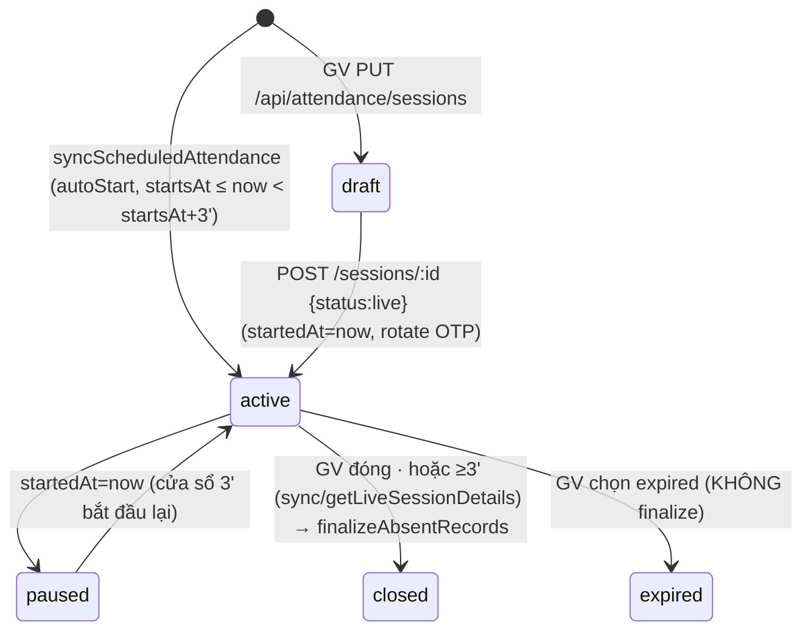

# SmartAttend — Attendance Lifecycle Design

> Trạng thái: **BLOCKED** đối với mọi thay đổi về thời lượng phiên và ngưỡng đi muộn (chờ chủ dự án quyết định). Tài liệu mô tả hành vi **hiện tại** (đã xác minh trong code) và các phương án đề xuất. **Logic nghiệp vụ chưa bị thay đổi.**

## 1. Năm khái niệm cần tách bạch
| Khái niệm | Định nghĩa | Hiện tại trong code |
|---|---|---|
| **OTP validity** | Thời gian một mã 6 ký tự còn hiệu lực | `attendance_policies.challenge_ttl_seconds` (mặc định **30 giây**); xoay khi GV poll (`getLiveSessionDetails`) hoặc bấm xoay |
| **Attendance window** | Khoảng thời gian SV được phép tự điểm danh | **3 phút hard-code** (`ATTENDANCE_WINDOW_MS` trong `syncScheduledAttendance` và `getLiveSessionDetails`; UI `180` giây trong `components/smart-attend.tsx` ~4196–4207, 4613, 4859) |
| **Class duration** | Độ dài buổi học | `course_sections.starts_at`–`ends_at`; **không** dùng cho điểm danh |
| **Late threshold** | Sau bao lâu thì `present` thành `late` | `attendance_policies.late_after_minutes` (mặc định **10**), tính từ `started_at` |
| **Session expiration** | Khi phiên tự đóng và chốt vắng | Cùng 3 phút với attendance window; áp cho **mọi** phiên active (kể cả phiên GV mở tay); phiên từ hôm trước cũng bị đóng |

**Mâu thuẫn đã xác nhận:** late threshold (10 phút) lớn hơn attendance window (3 phút), nên với cấu hình mặc định không thể có trạng thái `late` qua tự điểm danh.

## 2. Luồng hiện tại

**Ai kích hoạt đồng bộ:** `syncScheduledAttendance(org)` được gọi (1) bởi `/api/cron/sync-attendance` (chưa có lịch chạy nào trong repo), và (2) **trong mọi** `listClassSessions` và `getLiveSessionDetails`, tức là mỗi lần một người dùng bất kỳ poll dashboard (5 giây khi có phiên live, 15 giây khi không).

## 3. Câu hỏi cần chủ dự án trả lời
1. Phiên GV mở thủ công có tự đóng không? Nếu có, sau bao lâu?
2. "3 phút" là thời hạn **cửa sổ điểm danh**, không phải thời hạn OTP (OTP là 30 giây). Có giữ 3 phút cho phiên tự động theo lịch không?
3. SV được điểm danh muộn tối đa bao lâu (`late`)? Sau thời điểm nào thì không được điểm danh nữa (chốt `absent`)?
4. Các mốc trên đặt theo trường, theo lớp học phần, hay theo từng phiên?
5. Cron cần chạy mỗi phút hay tần suất khác? (Gói Hobby của Vercel chỉ cho 1 lần/ngày.)
6. Khi cron lỗi hoặc trễ, phiên đang mở xử lý thế nào: giữ mở tới lần chạy kế tiếp, hay tự đóng theo `started_at` khi có người truy cập (như hiện nay)?

## 4. Phương án đề xuất (chưa triển khai)
**A. Cấu hình theo trường (khuyến nghị):** thêm vào `attendance_policies`:
- `on_time_minutes` (đúng giờ);
- `late_until_minutes` (được điểm danh muộn tới; điều kiện `late_until ≥ on_time`);
- `auto_close_manual_sessions` (boolean).

Server trả `durationSeconds` cho UI (bỏ `180` hard-code). `verifyAttendance` tính `present` / `late` / từ chối theo hai mốc. Cần migration thêm cột, với giá trị mặc định **giữ đúng hành vi hiện tại** (`on_time = late_until = 3`, `auto_close_manual = true`) để không đổi nghiệp vụ cho tới khi trường cấu hình.

**B. Theo lớp học phần:** như A nhưng đặt trên `course_sections` (linh hoạt hơn, UI phức tạp hơn).

**C. Giữ nguyên 3 phút:** chỉ sửa mâu thuẫn, bằng cách ép `late_after_minutes ≤ 3` ở validation và hiển thị cảnh báo trong màn hình chính sách.

## 5. Kế hoạch tách đồng bộ khỏi polling (sau khi có cron)
1. Cấu hình cron (Vercel Pro `* * * * *`, hoặc scheduler ngoài) gọi `/api/cron/sync-attendance` với `Authorization: Bearer <CRON_SECRET>`.
2. Theo dõi 1–2 tuần trên staging để xác nhận phiên được mở và đóng đúng giờ chỉ nhờ cron.
3. Gỡ `syncScheduledAttendance` khỏi `listClassSessions`. Giữ một kiểm tra nhẹ trong `getLiveSessionDetails` (đóng phiên quá hạn **của chính phiên đang xem**, có điều kiện `WHERE status='active'`) để chịu lỗi khi cron trễ.
4. Chống chạy chồng: bảng `job_runs(job, minute_bucket)` với `INSERT … ON CONFLICT DO NOTHING`. Advisory lock không dùng được với neon-http stateless.
5. Ghi kết quả mỗi lần chạy (số phiên mở, đóng, lỗi) vào log hoặc `audit_logs` để giám sát.

**Đã có sẵn (không phụ thuộc quyết định):** tự mở phiên theo lịch đã race-safe (partial unique index + `ON CONFLICT DO NOTHING`, cần migration 0005); endpoint cron có xác thực constant-time.
